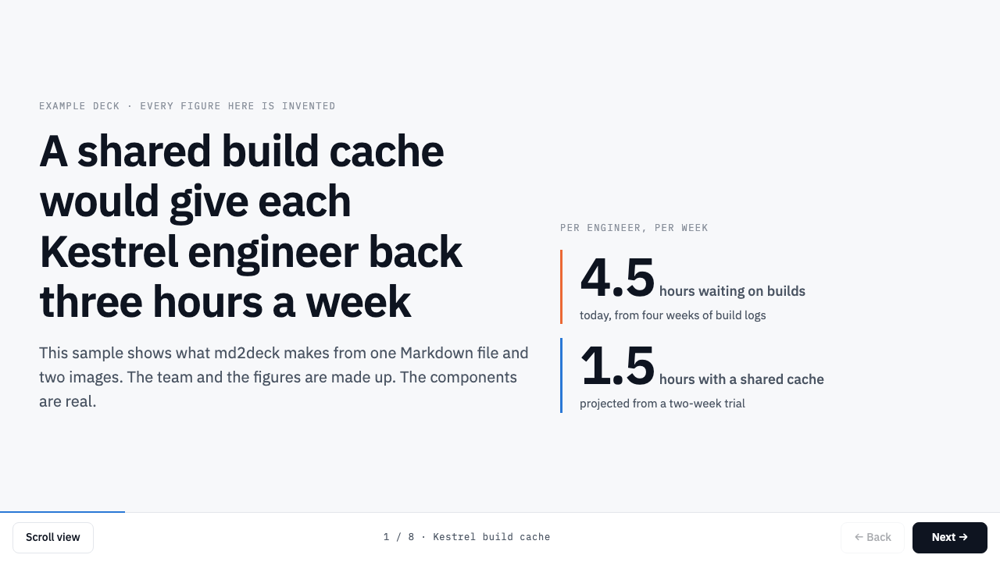
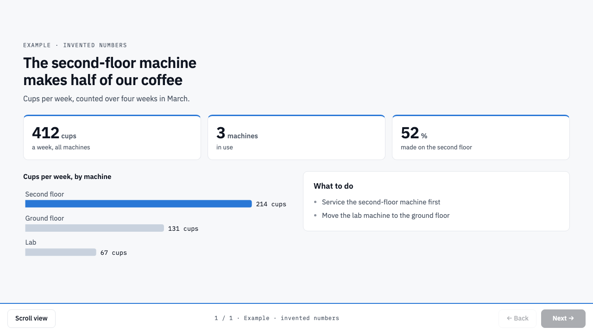
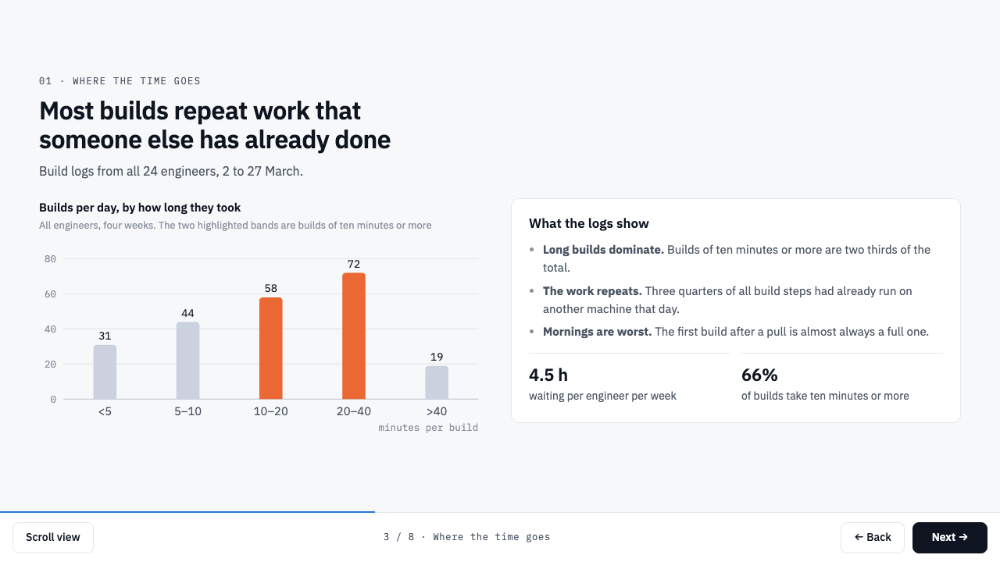
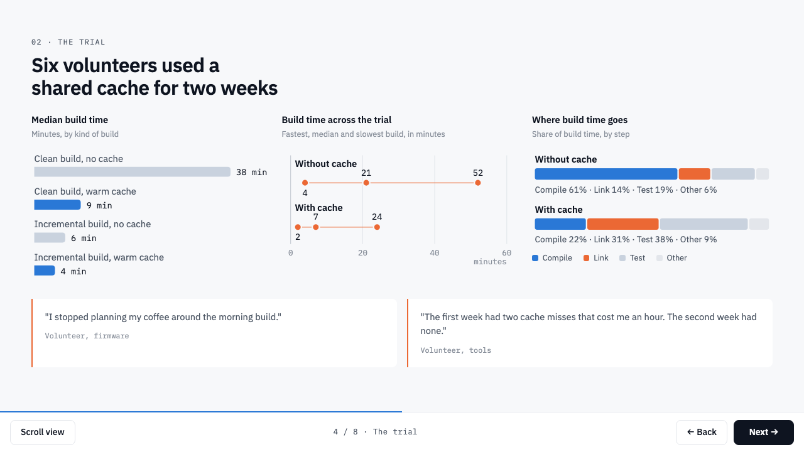

# md2deck

md2deck lets an AI coding agent make a slide deck by writing Markdown, not HTML.

An agent that writes a deck as HTML pays for the styling, the script and the chart-drawing code on top of the content, and pays again on every revision.
With md2deck the agent writes only the content: text, numbers and image files.
One command then builds the HTML deck and adds the layout, the charts, light and dark mode, and the Back and Next buttons.

For a real 20-slide deck with 17 charts, this cut what the agent had to write from 84 KB to 38 KB.

The tool is one Python file with no dependencies. The output is one `.html` file that opens in any browser and can be emailed or attached.
A person can write the Markdown too.



## Quick start

### 1. Download the script

```sh
curl -fsSLO https://raw.githubusercontent.com/ashutshkumr/md2deck/main/md2deck.py
```

It needs Python 3.8 or newer and nothing else. There is nothing to install.

### 2. Create `deck.md`

Save this as `deck.md` in the same folder:

````markdown
---
title: Coffee report
---

###### Example · invented numbers
## The second-floor machine makes half of our coffee

Cups per week, counted over four weeks in March.

::: tiles accent
412 | cups | a week, all machines
3 | machines | in use
52 | % | made on the second floor
:::

::: cols
#### Cups per week, by machine
```chart bars
unit: cups
Second floor | 214 *
Ground floor | 131
Lab | 67
```
+++
::: card
### What to do
- Service the second-floor machine first
- Move the lab machine to the ground floor
:::
:::
````

### 3. Run it

```sh
python3 md2deck.py deck.md
```

This writes `deck.html` next to `deck.md`. Open it in a browser:



What each piece became:

| In the Markdown | On the slide |
|---|---|
| `###### Example · invented numbers` | The small upper-case label above the title |
| `## The second-floor machine ...` | The slide title |
| The paragraph under it | The muted lead text |
| `::: tiles accent` with three rows | The three boxes with a big number, a unit and a label |
| `::: cols` and `+++` | Two columns |
| `#### Cups per week, by machine` | The chart's title |
| The `chart bars` block | The bar chart. The row ending in ` *` is highlighted. |
| `::: card` | The white box holding the heading and list |

A line holding only `---` starts the next slide.

## Ask an AI agent to make the deck

The quick start is what an agent does for you. Give it the topic and the content, and tell it to use md2deck.

### For one deck

Paste this into the agent's chat and replace the first line:

```text
Make a slide deck about <topic> for <audience>. Cover <the points, numbers or files to use>.

Use md2deck for this. Do not write HTML.
1. If md2deck.py is not in this folder, download it:
   curl -fsSLO https://raw.githubusercontent.com/ashutshkumr/md2deck/main/md2deck.py
2. Run: python3 md2deck.py --format
   Read the output. It is the complete format reference.
3. Write the deck as deck.md. Put numbers in ```chart blocks or tables. Save any other
   picture as an SVG or PNG under images/ and reference it as .
4. Run: python3 md2deck.py deck.md
   If it prints an error, fix that line of deck.md and run it again.
5. Tell me where deck.html is.
```

### For every deck in a project

Put this in the project's agent instructions, such as `CLAUDE.md` or `AGENTS.md`.
After that, a request as short as "make a deck from the Q3 results" is enough.

```text
Build slide decks with md2deck, not as hand-written HTML.
- If md2deck.py is missing, download it:
  curl -fsSLO https://raw.githubusercontent.com/ashutshkumr/md2deck/main/md2deck.py
- Read the format first: python3 md2deck.py --format
- Write the deck as deck.md. Put numbers in ```chart blocks or tables. Save any other
  picture as an SVG or PNG under images/ and reference it as .
- Build with: python3 md2deck.py deck.md
  If it prints an error, fix that line of deck.md and build again.
- To change the deck, edit deck.md and rebuild. Do not read or edit the HTML.
```

### To change a deck

Ask in plain words and name the file to edit:

```text
On slide 4, add March to the chart and highlight it.
Edit deck.md and rebuild with md2deck.py. Do not edit deck.html.
```

The second line is not needed in a project that has the instructions above.

### Why this saves tokens

An agent pays for every character it writes and every character it reads back. With this tool it never writes or reads the page's styling, script or chart drawing code, and it never handles image bytes.

| Deck | The agent writes | The HTML that results |
|---|---:|---:|
| `example/minimal.md`, 1 slide | 0.5 KB | 19 KB |
| `example/deck.md`, 8 slides, 6 charts, 3 image files | 5.6 KB | 122 KB |
| A real 20-slide deck with 17 charts | 38 KB | 97 KB |

The 20-slide deck was first written by an agent directly as HTML. That version was 84 KB, so the Markdown is 54% smaller.
At roughly four characters to a token, that is about 9,600 tokens in place of 21,000 each time the deck is written out in full.
These sizes are measured. The token counts are estimates from the sizes.

The saving repeats on every change:

- **Small edits stay small.** Changing a number in a chart is a one-line edit. The agent does not regenerate the chart's drawing code.
- **Less to read back.** To revise a deck, the agent reads the Markdown. The 16 KB of styling and script in every deck never enters its context.
- **Images cost nothing.** A 30 KB PNG is about 40 KB once embedded. The tool does that step, so the agent only writes the file's path.
- **Mistakes are cheap.** A typo in a chart option stops the build with one line of explanation. The agent does not have to find a layout bug in rendered HTML.

## The format

[FORMAT.md](FORMAT.md) lists everything the tool understands: slides, text, tables, columns, cards, six chart types, images, formulas and raw HTML.
The same text is built into the tool, so one file is enough:

```sh
python3 md2deck.py --format
```

## A fuller example

[example/deck.md](example/deck.md) uses every part of the format in eight slides, with an SVG diagram and a PNG screenshot from [example/images/](example/images/).
[example/deck.html](example/deck.html) is what the tool makes from it. Download that file and open it to try the deck. All its figures are invented.





## Images

Put pictures next to the Markdown file and reference them on a line of their own:

```markdown

```

The tool embeds each file in the HTML, so the deck stays one file. PNG, JPG, GIF, WebP and AVIF are embedded as they are.
SVG files are placed inline, so they can use the deck's colours and follow dark mode.
If `chart.dark.png` sits next to `chart.png`, it is shown in dark mode.

## Commands

| Command | What it does |
|---|---|
| `python3 md2deck.py deck.md` | Writes `deck.html` next to the input |
| `python3 md2deck.py deck.md -o out.html` | Writes to the given path. `-o -` writes to standard output. |
| `python3 md2deck.py deck.md --fragment` | Leaves out the `<html>`, `<head>` and `<body>` wrapper, for hosts that add their own, such as Claude artifacts |
| `python3 md2deck.py --format` | Prints the format reference |
| `python3 md2deck.py --version` | Prints the version |

## In the browser

The deck opens in slide view. Use the Next and Back buttons, the arrow keys, space, Page Up and Page Down. Home and End jump to the first and last slide.
"Scroll view" shows all slides as one page, which is what to print. Adding `#7` to the address opens slide 7.

## Changing the tool

[AGENTS.md](AGENTS.md) has the rules the tool must keep, a map of the code and the steps for common changes.
An agent working in this repository reads it on its own, and `CLAUDE.md` imports the same file for Claude Code. In short:

- Colours and fonts are the CSS variables at the top of the `CSS` block in `md2deck.py`.
- Run the tests with `python3 -m unittest discover tests`.
- `FORMAT.md` is generated. After changing the `FORMAT` text in the tool, run `python3 md2deck.py --format > FORMAT.md`.
- After a change that affects output, rebuild the examples: `python3 md2deck.py example/deck.md` and `python3 md2deck.py example/minimal.md`.
