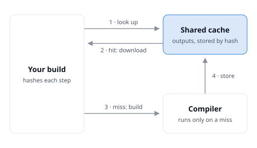
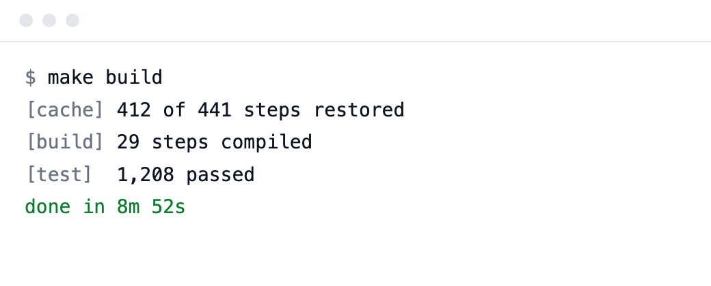

<!-- An example deck. The team, the story and every number are invented; they only show the components. -->

###### Example deck · every figure here is invented
# A shared build cache would give each Kestrel engineer back three hours a week

This sample shows what md2deck makes from one Markdown file and two images. The team and the figures are made up. The components are real.

###### Per engineer, per week
::: stat warm
4.5 | hours waiting on builds | today, from four weeks of build logs
:::
::: stat accent
1.5 | hours with a shared cache | projected from a two-week trial
:::

---

###### The case in brief
## What we propose, and why

::: summary
Problem | Every engineer rebuilds the same code. A clean build takes 38 minutes.
Evidence | 24 engineers, four weeks of build logs, and a two-week trial with six volunteers.
The ask | **One shared cache server and two weeks of setup work.**
Return | Three hours a week for each engineer. Across the team that is the time of 1.8 engineers.
:::

::: tiles accent
38 | min | for a clean build today
9 | min | for the same build with a warm cache
76 | % | of build steps are identical between two engineers
:::

---

###### 01 · Where the time goes
## Most builds repeat work that someone else has already done

Build logs from all 24 engineers, 2 to 27 March.

::: cols
#### Builds per day, by how long they took
-# All engineers, four weeks. The two highlighted bands are builds of ten minutes or more
```chart columns
color: warm
x: minutes per build
tip: builds a day
<5 | 31
5–10 | 44
10–20 | 58 *
20–40 | 72 *
>40 | 19
```
+++
::: card
### What the logs show
- **Long builds dominate.** Builds of ten minutes or more are two thirds of the total.
- **The work repeats.** Three quarters of all build steps had already run on another machine that day.
- **Mornings are worst.** The first build after a pull is almost always a full one.

::: facts
4.5 h | waiting per engineer per week
66% | of builds take ten minutes or more
:::
:::
:::

---

###### 02 · The trial
## Six volunteers used a shared cache for two weeks

::: cols
#### Median build time
-# Minutes, by kind of build
```chart bars
unit: min
Clean build, no cache | 38
Clean build, warm cache | 9 *
Incremental build, no cache | 6
Incremental build, warm cache | 4 *
```
+++
#### Build time across the trial
-# Fastest, median and slowest build, in minutes
```chart range
x: minutes
unit: min
| fastest | median | slowest
Without cache | 4 | 21 | 52
With cache | 2 | 7 | 24
```
+++
#### Where build time goes
-# Share of build time, by step
```chart share
| Compile | Link | Test | Other
Without cache | 61 | 14 | 19 | 6
With cache | 22 | 31 | 38 | 9
```
:::

> "I stopped planning my coffee around the morning build." -- Volunteer, firmware

> "The first week had two cache misses that cost me an hour. The second week had none." -- Volunteer, tools

---

###### 03 · How it works
## Build outputs are stored once and fetched by everyone

::: cols

+++
#### What happens on each build
::: steps
Hash | each step's inputs are hashed | < 1 s
Look up | the hash is checked against the shared cache | 2 s
> **On a hit,** the output is downloaded and the step is skipped
Build | only the steps that missed are run | varies
Store | new outputs are uploaded for the next person | 3 s
:::
:::

---

###### 04 · Why now
## The clean build gets slower every quarter

::: cols
#### Clean build time, in minutes
-# First working day of each quarter
```chart line
unit: min
every: 2
2024 Q1 | 14
2024 Q2 | 17
2024 Q3 | 19
2024 Q4 | 24
2025 Q1 | 27
2025 Q2 | 31
2025 Q3 | 35
2025 Q4 | 38
```
+++

:::

---

###### 05 · The plan
## Two weeks of setup, then measure

::: cards accent warm
###### Week 1 · Set up
1. Install the cache server
2. Point the CI builds at it
3. Check that cached and uncached builds give the same output
---
Done when **CI builds read from and write to the cache**
+++
###### Week 2 · Roll out
1. Switch the cache on for all 24 engineers
2. Publish the hit rate on the team dashboard
---
Done when **the hit rate stays above 70%**
+++
###### Week 6 · Review
- Compare four weeks of build logs with March
- Decide whether a second cache region is worth it
:::

| Option | Cost | Clean build | Verdict |
|---|---|---:|---|
| Do nothing | None | 38 min | Gets slower as the code grows |
| Faster laptops | 24 laptops | 29 min | Helps once |
| **Shared cache** | 1 server | 9 min | Recommended | *

---

###### Appendix · The sums
## How three hours a week becomes 1.8 engineers

::: cards warm accent
###### Time lost today
```calc
per engineer = builds a week × minutes waiting
  = 30 × 9 min = **4.5 hours a week**
  team = 4.5 × 24 = **108 hours a week**
```
---
Waiting counts only builds that take more than five minutes.
+++
###### Time given back
```chart rows
Waiting today | 108 | warm
With a warm cache | 36 | accent | at the hit rate seen in the trial
```
```calc
  saved = 108 − 36 = **72 hours a week**
  = 72 ÷ 40 = **1.8 engineers**
```
---
The trial's hit rate was 71%.
:::

-# Every figure in this deck is invented. It exists to show what each piece of the format looks like.
